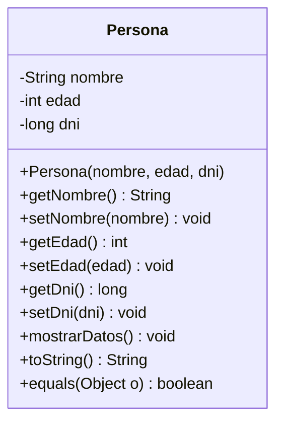
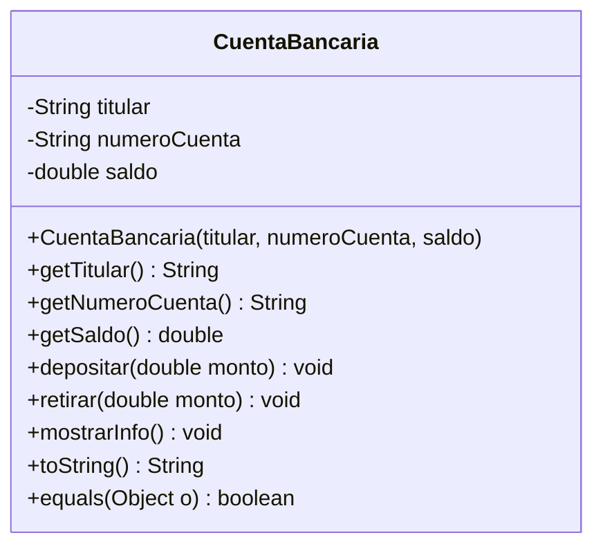
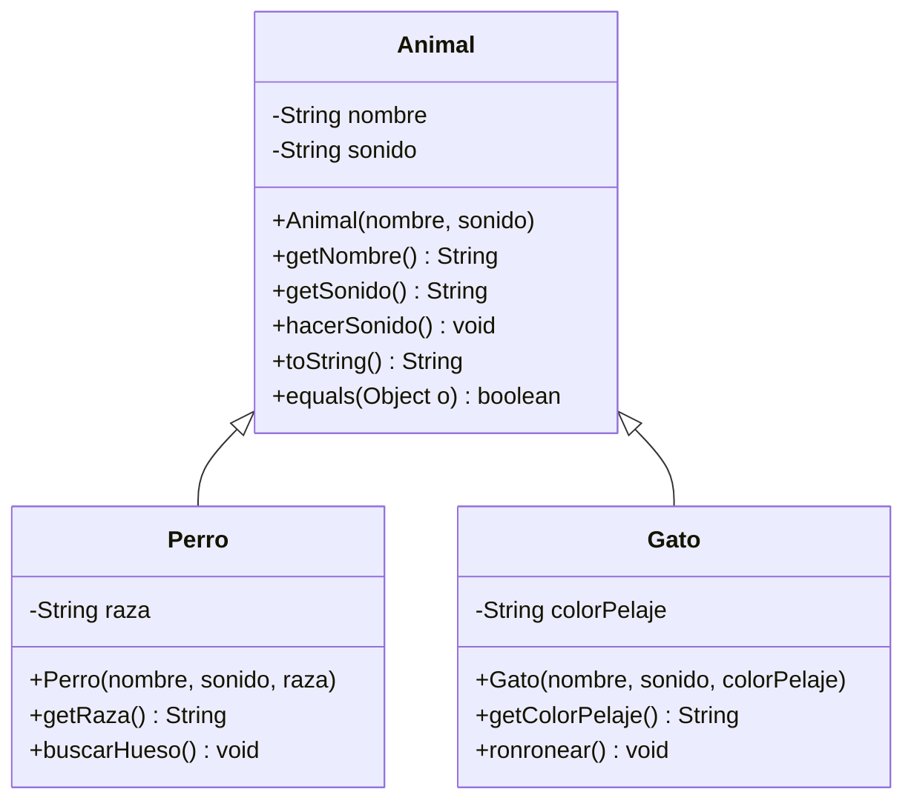
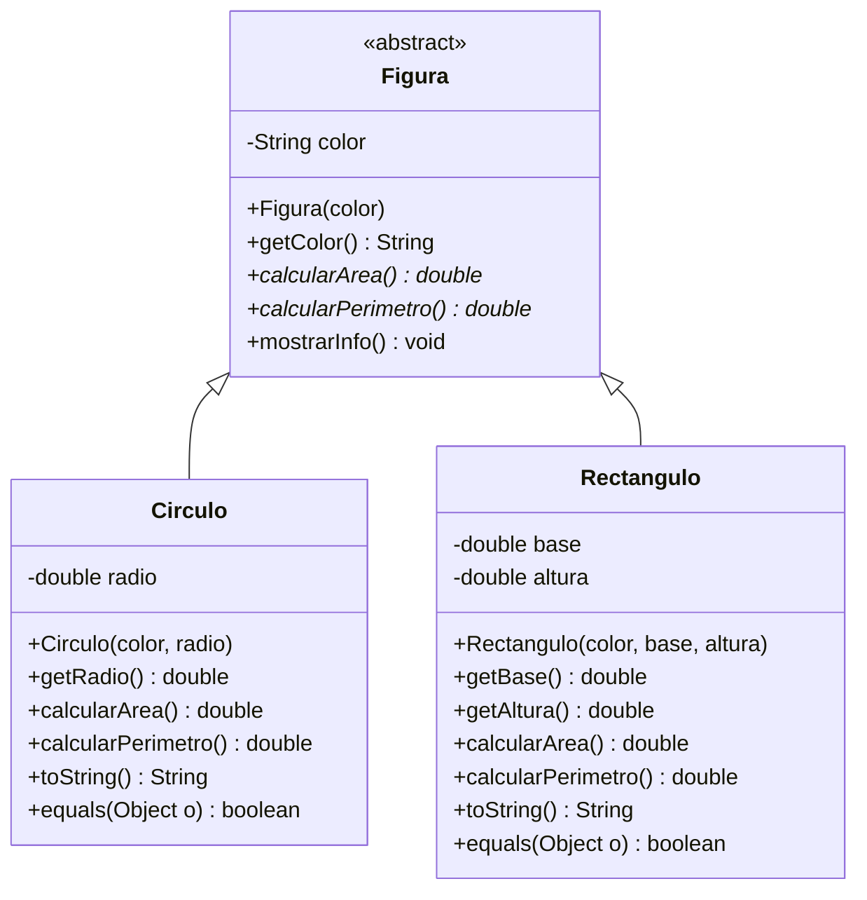
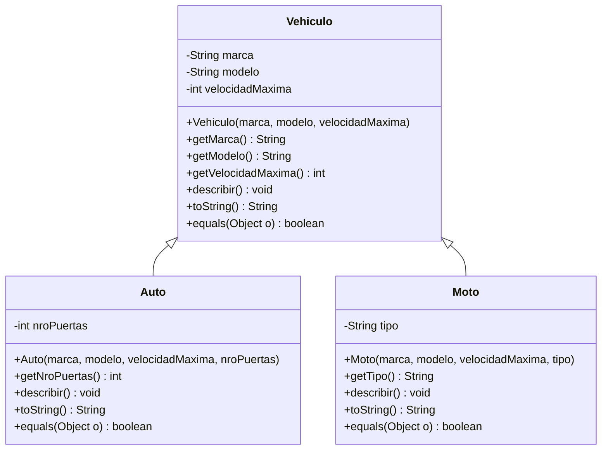
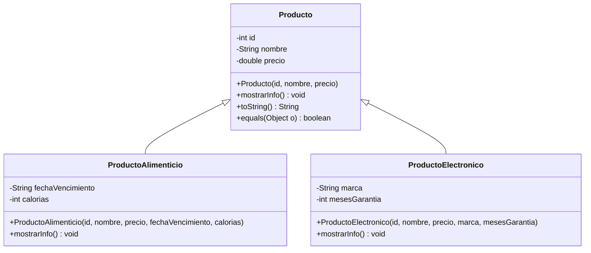
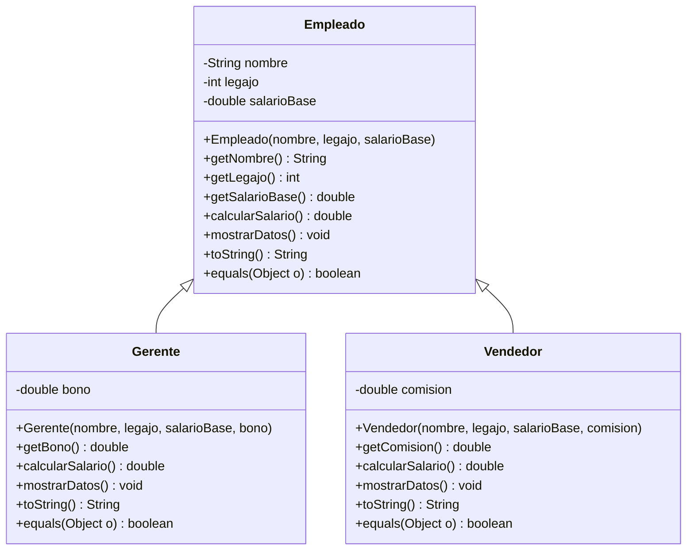

# TP – Desarrollo de Sistemas Orientada a Objetos

**Alumno:** [Tu nombre y apellido]

Resolución de la guía de ejercicios (7 ejercicios) en Java. Cada ejercicio está en su propio paquete dentro de `src/` y tiene su clase `Main` para probarlo.

## Estructura

```
src/
├── ejercicio1/   Persona
├── ejercicio2/   CuentaBancaria
├── ejercicio3/   Animal, Perro, Gato
├── ejercicio4/   Figura (abstracta), Circulo, Rectangulo
├── ejercicio5/   Vehiculo, Auto, Moto
├── ejercicio6/   Producto, ProductoAlimenticio, ProductoElectronico
└── ejercicio7/   Empleado, Gerente, Vendedor
```

## Cómo ejecutar

Desde la raíz del repositorio:

```bash
javac -d out src/ejercicio*/*.java
java -cp out ejercicio1.Main
```

Cambiando `ejercicio1` por el número que corresponda. También se puede abrir la carpeta en IntelliJ, Eclipse, NetBeans o VS Code y ejecutar el `Main` de cada paquete.

---

## Ejercicio 1 – La Clase Persona



## Ejercicio 2 – Cuenta Bancaria Simple



## Ejercicio 3 – El Reino Animal



## Ejercicio 4 – Figuras Geométricas



## Ejercicio 5 – Sistema de Vehículos



## Ejercicio 6 – Sistema de Productos



## Ejercicio 7 – Sistema de Empleados


